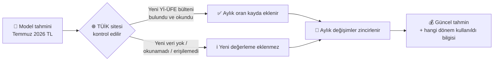
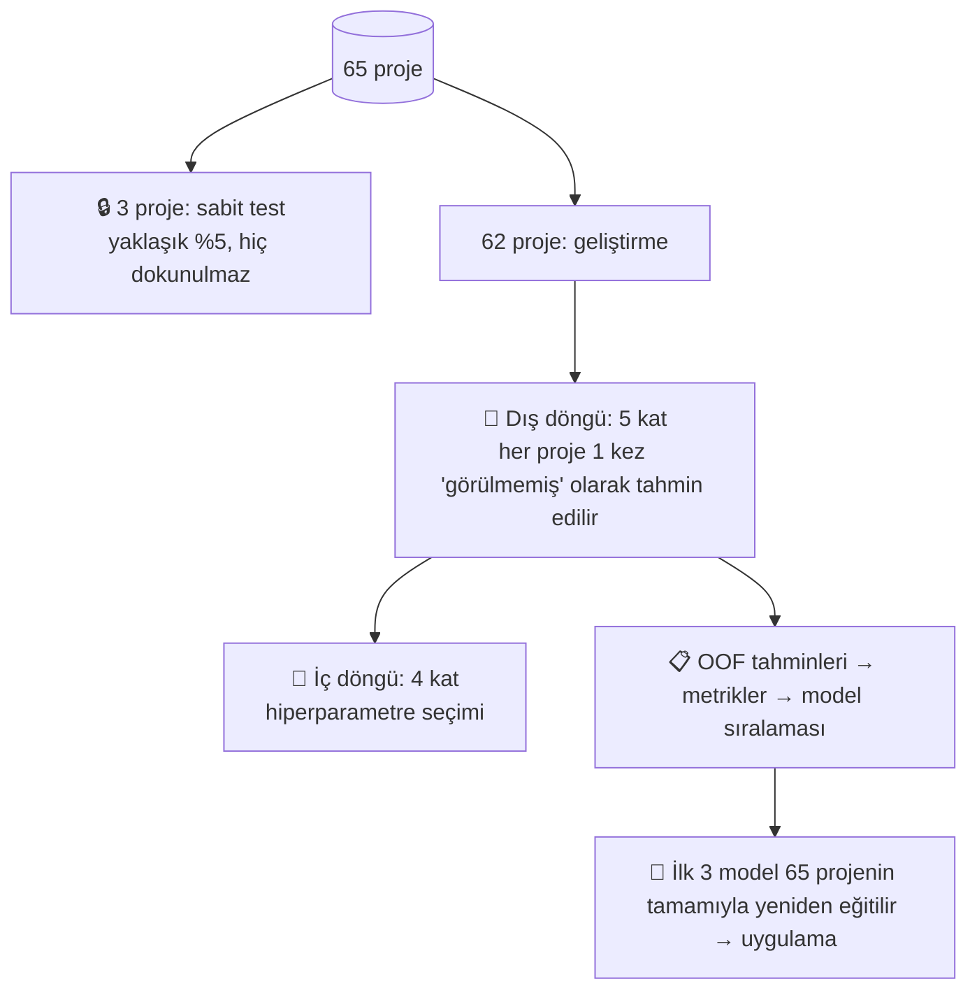
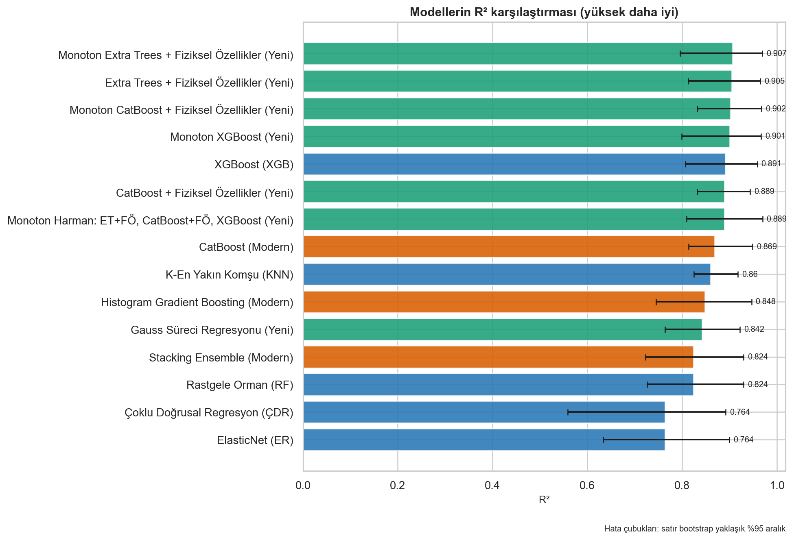
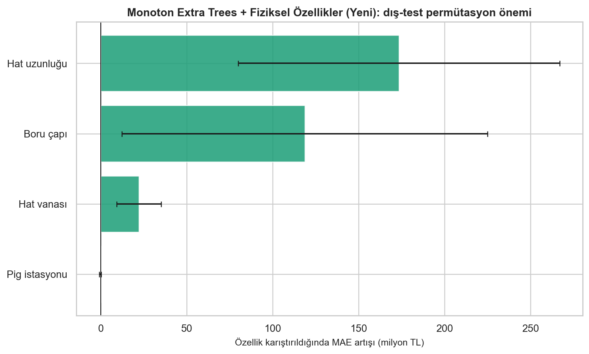
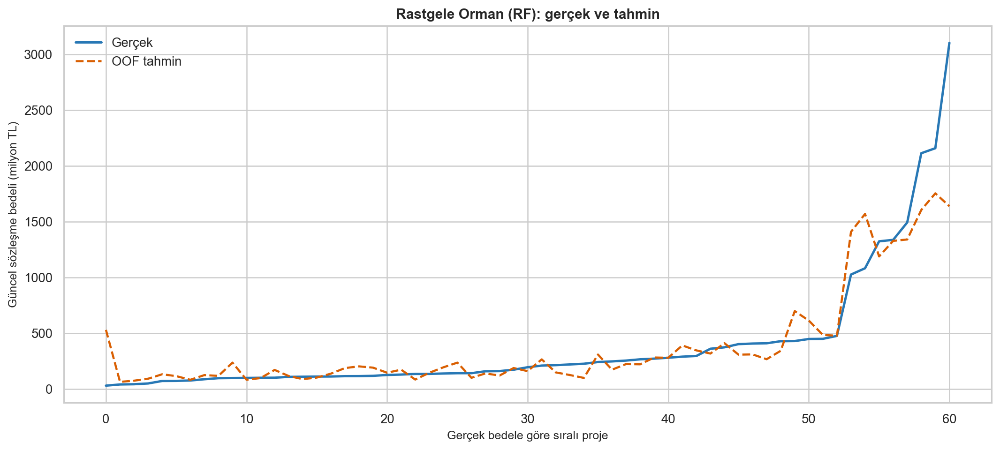

# 🏗️ Doğal Gaz Boru Hattı İhale Bedeli Tahmin Uygulaması


> 💡 **Kısaca:** Bir doğal gaz boru hattı projesinin **4 teknik özelliği** girilir, uygulama makine öğrenmesiyle projenin **güncel sözleşme bedelini (TL)** tahmin eder. Tahmin, **TÜİK Yurt İçi Üretici Fiyat Endeksi (Yİ-ÜFE)** ile bugünün fiyatlarına yeniden değerlenir.

📑 **İçindekiler**
[🎯 Amaç](#-amaç) · [📦 Veri ve öznitelikler](#-veri-ve-öznitelikler) · [💱 TÜİK yeniden değerleme](#-tüi̇k-yi̇-üfe-ile-yeniden-değerleme) · [🧠 Yöntemler](#-kullanılan-makine-öğrenmesi-yöntemleri) · [🧪 Doğrulama](#-modeller-nasıl-sınandı) · [📏 Metrikler](#-hata-metrikleri-ve-nasıl-yorumlanır) · [🏆 Sonuçlar](#-sonuçlar) · [🚀 Kurulum](#-kurulum-ve-kullanım) · [🗂️ Proje yapısı](#️-proje-yapısı) · [⚠️ Sınırlamalar](#️-sınırlamalar)

---

## 🎯 Amaç

Kamu ihalelerinde doğal gaz boru hattı (DGBH) projelerinin **yaklaşık maliyeti**, keşif ve metraj çalışmaları tamamlanmadan önce bilinmek istenir. Bu uygulama:

- 📐 Projenin yalnızca **dört temel teknik bilgisinden** hızlıca bir **ön maliyet tahmini** üretir,
- 📈 Geçmiş **65 gerçekleşmiş ihaleden** öğrenir,
- 💱 Tahmini **TÜİK Yİ-ÜFE** ile **en son yayımlanmış aya** taşır,
- ⚠️ Girdi, geçmiş projelerin aralığı dışındaysa kullanıcıyı uyarır.

Çalışma, Coşkun Çakmak'ın *"Doğal Gaz Boru Hattı İnşaat Maliyetlerinin Ön Tahmini İçin Bir Yöntem Önerisi"* (Ocak 2025) doktora tezinden yöntemsel olarak yararlanır; tezin beş modeli korunmuş, üç modern model eklenmiş ve doğrulama düzeni küçük veri için daha sağlam hale getirilmiştir. Ayrıntılı karşılaştırma: [tez_analizi_ve_metodoloji.md](tez_analizi_ve_metodoloji.md).

> 🧭 Uygulama bir **karar destek aracıdır**; keşif, piyasa koşulları ve mühendislik değerlendirmesinin yerine geçmez.

---

## 📦 Veri ve öznitelikler

Kaynak dosya: `VERİLER_GÜNCELLENMİŞ.xlsx` — **65 proje**.

| | Öznitelik | Birim | Eğitim aralığı (min – medyan – maks) | Neden önemli? |
|---|---|---|---|---|
| 🔩 | **Boru çapı** | inç | 6 – 12 – 48 | Çap büyüdükçe çelik miktarı, kaynak ve işçilik artar. |
| 📏 | **Hat uzunluğu** | km | 5,07 – 43,23 – 289,6 | Maliyetin en güçlü belirleyicisi. |
| 🚰 | **Hat vanası sayısı** | adet | 0 – 1 – 10 | Vana istasyonları ek ekipman ve inşaat demektir. |
| 🧽 | **PİG istasyonu sayısı** | adet | 0 – 2 – 4 | Hat temizleme/denetim istasyonları. |
| 🎯 | **Hedef: Güncel sözleşme bedeli** | TL | 30,1 mn – 190,0 mn – 5,49 mr | Temmuz 2026 Yİ-ÜFE düzeyine güncellenmiş bedel. |

📌 Notlar:
- `TAKE OFF VANA SAYISI` dosyada vardır ancak talimat gereği modele alınmaz.
- `SIRA NO`, proje adı, sözleşme tarihi ve nominal bedel **model girdisi değildir**; yalnızca denetim ve raporlama için tutulur.
- Bu bir **zaman serisi çalışması değildir**; satırlar kronolojik kabul edilmez.
- Hedef sağa çarpıktır: projelerin çoğu 100–400 milyon TL aralığında, birkaç proje milyar TL düzeyindedir. Bu durum metriklerin yorumunu doğrudan etkiler (aşağıya bakın).

---

## 💱 TÜİK Yİ-ÜFE ile yeniden değerleme

Eğitim verisindeki bütün bedeller **Temmuz 2026 Yİ-ÜFE** düzeyine güncellenmiştir; bu nedenle model çıktısı da Temmuz 2026 fiyatlarıyladır. Uygulama **her tahmin öncesinde** TÜİK sitesini kontrol eder ve sonucu yayımlanmış **en son Yİ-ÜFE dönemine** taşır.



**Hesap:**

```text
Katsayı = Π (1 + aylık Yİ-ÜFE değişimi / 100)   (baz dönemden sonraki her ay için)
Güncel tahmin = Model tahmini × Katsayı
```

Örnek (31.10.2026 itibarıyla): Ağustos 2026 **%2,57**, Eylül 2026 **%2,07** → katsayı **1,0257 × 1,0207 = 1,0469**. Yani Temmuz 2026 fiyatıyla 100 milyon TL olan bir tahmin, Eylül 2026 fiyatıyla **≈104,7 milyon TL** olarak gösterilir.

**Kullanıcıya gösterilen bilgiler**

| Durum | Ekranda görülen |
|---|---|
| 🔎 Arama sürerken | "TÜİK sitesinde güncel Yİ-ÜFE verisi aranıyor…" ve adım adım ilerleme mesajları |
| ✅ Yeni veri bulundu | Eklenen dönem, yeni katsayı ve kullanılan aylar |
| ℹ️ Yeni veri yok | "Yeni değerleme eklenmedi. Son değerleme **Eylül 2026** dönemine aittir." |
| ⚠️ Okunamadı / ❌ Erişilemedi | Tahmin yine yapılır; son kayıtlı değerlemenin **yıl ve ayı** açıkça belirtilir |

**Kayıt dosyası:** [veri/yi_ufe_aylik_degisim.csv](veri/yi_ufe_aylik_degisim.csv) — her ayın Yİ-ÜFE aylık değişimi, kaynağı ve kayıt tarihi. TÜİK'ten otomatik okunan oranlar bu dosyaya eklenir.

> 🔐 **Bilinmesi gereken teknik kısıt:** TÜİK'in **Parasal Değeri Güncelleme Aracı** (ty.tuik.gov.tr) kullanıcı girişi gerektirir; yeni **veri portalı** (veriportali.tuik.gov.tr) ise içeriği tarayıcıda JavaScript ile yükler ve programatik isteklere kapalıdır. Uygulama bu nedenle herkese açık TÜİK ana sayfasındaki bülten listesini tarar; yeni Yİ-ÜFE bülteni orada görünür ve metni okunabilirse oranı otomatik ekler. Okunamadığında uygulamanın kenar çubuğundaki **"➕ TÜİK oranını elle ekle"** formuyla oran birkaç saniyede girilebilir. Model hata metrikleri (RMSE, MAE) Temmuz 2026 fiyat bazındadır.

---

## 🧠 Kullanılan makine öğrenmesi yöntemleri

Toplam **8 model** karşılaştırılır: tezdeki 5 klasik model + 3 modern model.

| | Model | Grup | Teknik olmayan açıklama |
|---|---|---|---|
| 📉 | **Çoklu Doğrusal Regresyon (ÇDR)** | Tez | "Her km şu kadar, her inç şu kadar TL ekler" diyen düz bir formül. Basit ve açıklanabilir, ancak ilişki doğrusal değilse yetersiz kalır. |
| 🧷 | **ElasticNet (ER)** | Tez | Doğrusal formülün "aşırı ezberlemeye" karşı frenlenmiş hali; gereksiz etkileri küçültür. |
| 👥 | **K-En Yakın Komşu (KNN)** | Tez | "Bu projeye en çok benzeyen 5 geçmiş proje ne kadar tuttuysa, bu da ona yakın tutar." |
| 🌳 | **Rastgele Orman (RF)** | Tez | Yüzlerce karar ağacı ("çap > 16 inç mi? uzunluk > 50 km mi?") kurulur, hepsinin ortalaması alınır. Kalabalığın bilgeliği. |
| ⚡ | **XGBoost (XGB)** | Tez | Ağaçlar sırayla kurulur; her yeni ağaç bir öncekinin hatasını düzeltmeye çalışır. |
| 🐈 | **CatBoost** | Modern | XGBoost benzeri, küçük veride kararlı olması için güçlü düzenlileştirme içerir. |
| 📊 | **Histogram Gradient Boosting (HGB)** | Modern | Değerleri aralıklara (kutulara) bölerek hızlı ve düzenli çalışan boosting yöntemi. |
| 🧩 | **Stacking Ensemble** | Modern | Ridge, RF ve HGB'nin tahminlerini bir "hakem" modelle birleştirir; farklı modellerin zayıflıklarını dengeler. |

🔧 Hiperparametreler her model için ızgara aramasıyla (`GridSearchCV`) seçilir. KNN ve ElasticNet'te ölçekleme yalnızca eğitim katı içinde yapılır (veri sızıntısı yok). Bedel negatif olamayacağı için tüm tahminler sıfırda kırpılır.

🏁 **Uygulamada kullanılan modeller:** Nested CV RMSE sıralamasında ilk 3 → **🥇 Rastgele Orman**, **🥈 Stacking Ensemble**, **🥉 XGBoost**. Üçünün tahmini yan yana gösterilir; birbirine yakın olmaları tahmine güveni artırır, çok farklı olmaları belirsizliğe işaret eder.

---

## 🧪 Modeller nasıl sınandı?



- **Birincil ölçüt — Nested (iç içe) çapraz doğrulama:** Her proje, onu hiç görmemiş bir modelle tahmin edilir (*out-of-fold, OOF*). Model seçimi ve hiperparametre ayarı ayrı döngülerde yapıldığı için sonuçlar **iyimser değildir**.
- **İkincil kontrol — %5 sabit test:** 3 proje. Bilgi verir ama 3 satırla güvenilir bir sıralama yapılamaz.
- **Belirsizlik:** Metriklerin yanında bootstrap ile yaklaşık %95 güven aralıkları ve OOF hatalarından yaklaşık %90 konformal tahmin aralığı hesaplanır.

---

## 📏 Hata metrikleri ve nasıl yorumlanır?

Aşağıdaki değerler **birinci sıradaki model (🌳 Rastgele Orman)** için nested CV OOF sonuçlarıdır (62 proje, Temmuz 2026 TL).

| Metrik | Ne ölçer? | İyi yön | RF sonucu | Nasıl okunur? |
|---|---|:---:|---:|---|
| 📈 **R²** | Bedellerdeki farklılığın ne kadarını model açıklıyor | ⬆️ 1'e yakın | **0,58** | Projeler arasındaki maliyet farklarının ~%58'ini yalnızca 4 özellikle açıklıyor. "%58 doğru" demek **değildir**. |
| 📐 **RMSE** | Büyük hataları ağır cezalandıran tipik hata | ⬇️ | **555,4 mn TL** | Tek bir dev projedeki (5,49 milyar TL) büyük ıskadan çok etkilenir. O proje hariç **173,8 mn TL**. |
| 📊 **NRMSE** | RMSE / ortalama bedel | ⬇️ | **%115,4** | Ortalamayı birkaç dev proje şişirdiği için yüksek görünür; çarpık veride tek başına yorumlanmamalı. |
| 📏 **MAE** | Ortalama mutlak hata | ⬇️ | **169,9 mn TL** | Bir tahmin ortalamada gerçekten ~170 mn TL sapıyor (dev projeler dahil). |
| 🎯 **MedAE** | Mutlak hataların medyanı | ⬇️ | **58,1 mn TL** | Projelerin **yarısında** hata 58 mn TL'nin altında. "Tipik proje" için en dürüst ölçü. |
| ％ **MAPE** | Ortalama yüzde hata | ⬇️ | **%53,5** | Küçük projelerdeki yüzde sapmalar ortalamayı yukarı çeker. |
| ⚖️ **WAPE** | Toplam mutlak hata / toplam bedel | ⬇️ | **%35,3** | Portföy düzeyinde: toplam 100 TL'lik işte ~35 TL'lik toplam sapma. |
| 🔢 **RMSLE** | Logaritmik (oransal) hata | ⬇️ | **0,51** | Tahminler tipik olarak gerçek değerin ~**1,7 katı / 1,7'de biri** bandında (e^0,51). |
| ↕️ **Bias** | Ortalama (tahmin − gerçek) | 0'a yakın | **−37,0 mn TL** | Hafif **düşük tahmin** eğilimi; güven aralığı (−198 / +66 mn) sıfırı kapsıyor → sistematik sapma kanıtı yok. |

🧠 **Pratik yorum:**
- 500 milyon TL altındaki **53 projede**: MAE **62,6 mn TL**, medyan yüzde hata **%25,5**.
- Projelerin yaklaşık **%60'ında** tahmin, gerçek bedelin **±%30** bandında.
- En büyük hatalar milyar TL'lik, eğitim verisinde az örneği bulunan dev projelerde oluşur → bu ölçekteki projelerde tahmin **kaba bir büyüklük göstergesi** olarak kullanılmalıdır.

<details>
<summary>📋 Sabit %5 test (3 proje) sonuçları — neden ana ölçüt değil?</summary>

Sabit testte en iyi R² **Histogram Gradient Boosting**'e aittir (R² 0,895; RMSE 22,6 mn TL; MAPE %28,6). Ancak bu 3 projenin üçü de 8 inçlik küçük projelerdir; 3 satırla model sıralaması istatistiksel olarak güvenilir değildir. HGB, 62 projelik nested CV'de 7. sıradadır (R² 0,415). Bu nedenle **model seçimi nested CV'ye göre yapılır**. Tablo: [sonuclar/model_performanslari.txt](sonuclar/model_performanslari.txt), yorum: [sonuclar/anlamlandırma.txt](sonuclar/anlamlandırma.txt).
</details>

---

## 🏆 Sonuçlar

**Nested CV OOF sıralaması (62 proje, RMSE'ye göre)**

| Sıra | Model | R² | RMSE (mn TL) | MAE (mn TL) | MedAE (mn TL) | MAPE | WAPE |
|:---:|---|---:|---:|---:|---:|---:|---:|
| 🥇 | Rastgele Orman (RF) | **0,580** | **555,4** | **169,9** | **58,1** | %53,5 | **%35,3** |
| 🥈 | Stacking Ensemble | 0,570 | 561,5 | 181,5 | 60,0 | %71,4 | %37,7 |
| 🥉 | XGBoost (XGB) | 0,541 | 580,6 | 176,0 | 59,0 | %54,1 | %36,6 |
| 4 | ElasticNet (ER) | 0,530 | 587,2 | 222,5 | 75,7 | %99,5 | %46,2 |
| 5 | K-En Yakın Komşu (KNN) | 0,511 | 599,3 | 202,7 | 62,6 | %51,3 | %42,1 |
| 6 | CatBoost | 0,463 | 627,9 | 195,3 | 59,3 | %51,6 | %40,6 |
| 7 | Histogram Gradient Boosting | 0,415 | 655,1 | 246,1 | 62,9 | %72,5 | %51,2 |
| 8 | Çoklu Doğrusal Regresyon (ÇDR) | 0,377 | 676,0 | 304,2 | 124,1 | %130,8 | %63,2 |

🔍 **En etkili öznitelikler** (permütasyon önemi): Hat uzunluğu ≫ Boru çapı ≫ Hat vanası > PİG istasyonu.

| R² karşılaştırması | Öznitelik önemi |
|---|---|
|  |  |



> 📉 Grafikte görüldüğü gibi RF, projelerin büyük çoğunluğunu yakından izler; en büyük sapma en sağdaki 5,49 milyar TL'lik projededir.

---

## 🚀 Kurulum ve kullanım

Doğrulanan ortam: **Windows + Python 3.10.11**. Kesin sürümler [requirements.txt](requirements.txt) içindedir.

| Adım | Komut | Ne yapar? |
|---|---|---|
| 1️⃣ Kurulum (bir kez) | `.\01_kurulum.cmd` | `.venv` oluşturur, eksik kütüphaneleri kurar. |
| 2️⃣ Eğitim (Excel değişince) | `.\02_egitim.cmd` | 8 modeli eğitir; raporları, grafikleri ve en iyi 3 modeli `sonuclar/` klasörüne yazar. |
| 3️⃣ Uygulama | `.\03_uygulamayi_baslat.cmd` | Tarayıcıda Streamlit arayüzünü açar. Kapatmak için `Ctrl+C`. |

**Arayüzde kullanım:**
1. 🔢 Boru çapı, hat uzunluğu, hat vanası ve PİG istasyonu sayısını girin.
2. ▶️ **"Güncel sözleşme bedelini tahmin et"** düğmesine basın.
3. 🔎 Uygulama TÜİK'i kontrol eder; ilerleme ekranda görünür.
4. 💰 En iyi 3 modelin tahmini **güncel dönem fiyatlarıyla** gösterilir; tabloda Temmuz 2026 bazlı değer de yer alır.
5. 📅 Kenar çubuğunda kayıtlı Yİ-ÜFE ayları ve elle oran ekleme formu bulunur.

⚡ Hızlı duman testi:

```powershell
.\.venv\Scripts\python.exe .\ihale_maliyet_modelleme.py --excel .\VERİLER_GÜNCELLENMİŞ.xlsx --output .\sonuclar_test --fast
```

---

## 🗂️ Proje yapısı

```text
📁 ihale_tahmin/
├── 🐍 ihale_maliyet_modelleme.py   # Eğitim: veri okuma, 8 model, nested CV, metrikler, grafikler
├── 🐍 tahmin_servisi.py            # Model yükleme, girdi doğrulama, tahmin
├── 🐍 tahmin_uygulamasi.py         # Streamlit arayüzü
├── 🐍 yeniden_degerleme.py         # TÜİK kontrolü ve Yİ-ÜFE yeniden değerleme
├── 🐍 model_schema.py              # Ortak öznitelik şeması
├── 📁 veri/yi_ufe_aylik_degisim.csv # Aylık Yİ-ÜFE değişim kaydı
├── 📊 VERİLER_GÜNCELLENMİŞ.xlsx     # Eğitim verisi (65 proje)
├── 📁 sonuclar/                     # Modeller, metrikler, tahminler, grafikler
├── 📁 sunum/                        # Yönetim sunumu (PowerPoint)
├── 📝 tez_analizi_ve_metodoloji.md  # Tez incelemesi ve metodoloji
└── ⚙️ 01_kurulum / 02_egitim / 03_uygulamayi_baslat (.cmd/.ps1)
```

**Önemli çıktılar (`sonuclar/`)**

| Dosya | İçerik |
|---|---|
| `model_performanslari.csv` | Nested CV OOF metrikleri + %95 güven aralıkları |
| `model_performanslari.txt` | Sabit test tablosu ve metrik açıklamaları |
| `yuzde5_holdout_metrikleri.csv` / `yuzde5_holdout_tahminleri.xlsx` | Sabit test sonuçları |
| `satir_bazli_tahminler.xlsx` | Her proje için gerçek değer ve tüm model tahminleri |
| `fiyat_guncelleme_denetimi.xlsx` | Nominal → güncel bedel ve güncelleme katsayısı |
| `en_iyi_3_model.joblib` / `model_manifest.json` | Uygulamanın kullandığı modeller ve meta bilgiler |
| `grafikler/` | Veri, model ve metrik grafikleri |

`*_DEGERLENDIRME_TAHMIN` sütunları bağımsız (OOF / sabit test) tahminlerdir; `*_TAM_TAHMIN` sütunları tüm veriyle eğitilmiş modelin uyum değerleridir ve performans ölçüsü olarak kullanılmamalıdır.

---

## ⚠️ Sınırlamalar

- 🔢 **Küçük veri:** 65 proje; özellikle milyar TL ölçeğindeki projeler az olduğu için bu bölgede hata büyüktür.
- 🧭 **Ekstrapolasyon:** Eğitim aralığı dışındaki girdilerde uygulama tahmin üretir ama uyarı verir.
- 🧱 **Eksik etkenler:** Arazi yapısı, bölge, zemin, kamulaştırma, malzemeli/malzemesiz ihale ayrımı gibi etkenler modelde yoktur.
- 💱 **Endeks:** Yİ-ÜFE genel bir üretici fiyat endeksidir; çelik boru veya inşaat maliyetindeki özel dalgalanmaları birebir yansıtmayabilir.
- 🌐 **TÜİK erişimi:** Otomatik okuma TÜİK'in herkese açık sayfalarına bağlıdır; okunamadığında son kayıtlı dönem kullanılır ve bu açıkça bildirilir.

---

📚 **Kaynak:** Çakmak, C. (2025). *Doğal Gaz Boru Hattı İnşaat Maliyetlerinin Ön Tahmini İçin Bir Yöntem Önerisi* (Doktora tezi). · 📊 Fiyat endeksi: [TÜİK](https://www.tuik.gov.tr/) Yurt İçi Üretici Fiyat Endeksi (2003=100).
