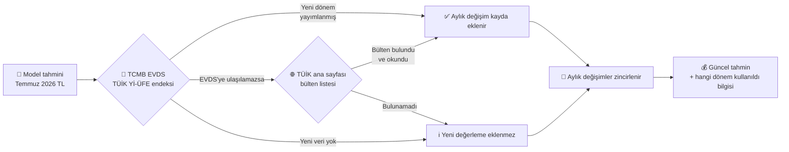
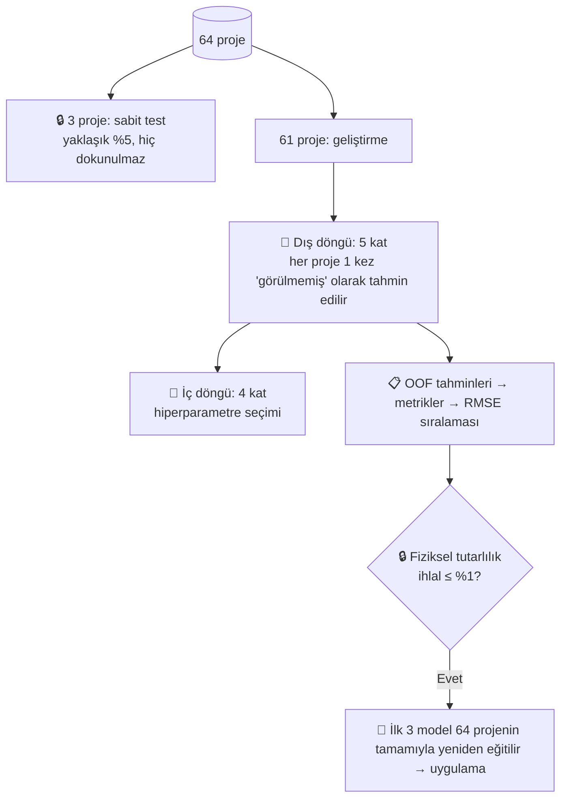
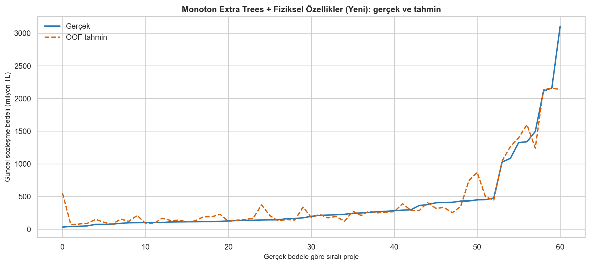

# 🏗️ Doğal Gaz Boru Hattı İhale Bedeli Tahmin Uygulaması


> 💡 **Kısaca:** Bir doğal gaz boru hattı projesinin **4 teknik özelliği** girilir, uygulama makine öğrenmesiyle projenin **güncel sözleşme bedelini (TL)** tahmin eder. Tahmin, **TÜİK Yurt İçi Üretici Fiyat Endeksi (Yİ-ÜFE)** ile bugünün fiyatlarına yeniden değerlenir.

📑 **İçindekiler**
[🎯 Amaç](#-amaç) · [📦 Veri ve öznitelikler](#-veri-ve-öznitelikler) · [💱 TÜİK yeniden değerleme](#-tüi̇k-yi̇-üfe-ile-yeniden-değerleme) · [🧠 Yöntemler](#-kullanılan-makine-öğrenmesi-yöntemleri) · [🧪 Doğrulama](#-modeller-nasıl-sınandı) · [📏 Metrikler](#-hata-metrikleri-ve-nasıl-yorumlanır) · [🏆 Sonuçlar](#-sonuçlar) · [🚀 Kurulum](#-kurulum-ve-kullanım) · [🗂️ Proje yapısı](#️-proje-yapısı) · [⚠️ Sınırlamalar](#️-sınırlamalar)

---

## 🎯 Amaç

Kamu ihalelerinde doğal gaz boru hattı (DGBH) projelerinin **yaklaşık maliyeti**, keşif ve metraj çalışmaları tamamlanmadan önce bilinmek istenir. Bu uygulama:

- 📐 Projenin yalnızca **dört temel teknik bilgisinden** hızlıca bir **ön maliyet tahmini** üretir,
- 📈 Geçmiş **64 gerçekleşmiş ihaleden** öğrenir (65 kayıttan 1'i kapsam farkı nedeniyle eğitim dışı),
- 💱 Tahmini **TÜİK Yİ-ÜFE** ile **en son yayımlanmış aya** taşır,
- ⚠️ Girdi, geçmiş projelerin aralığı dışındaysa kullanıcıyı uyarır.

Çalışma, Coşkun Çakmak'ın *"Doğal Gaz Boru Hattı İnşaat Maliyetlerinin Ön Tahmini İçin Bir Yöntem Önerisi"* (Ocak 2025) doktora tezinden yöntemsel olarak yararlanır; tezin beş modeli korunmuş; üç modern model ve **fiziksel özellik mühendisliği ile monoton kısıtlara dayanan yedi geliştirilmiş model** eklenmiş, doğrulama düzeni küçük veri için daha sağlam hale getirilmiştir. Ayrıntılı karşılaştırma: [tez_analizi_ve_metodoloji.md](tez_analizi_ve_metodoloji.md).

> 🧭 Uygulama bir **karar destek aracıdır**; keşif, piyasa koşulları ve mühendislik değerlendirmesinin yerine geçmez.

---

## 📦 Veri ve öznitelikler

Kaynak dosya: `VERİLER_GÜNCELLENMİŞ.xlsx` — **65 proje**; eğitimde **64 proje** kullanılır (aşağıdaki 🚫 nota bakın).

| | Öznitelik | Birim | Eğitim aralığı (min – medyan – maks) | Neden önemli? |
|---|---|---|---|---|
| 🔩 | **Boru çapı** | inç | 6 – 12 – 48 | Çap büyüdükçe çelik miktarı, kaynak ve işçilik artar. |
| 📏 | **Hat uzunluğu** | km | 5,07 – 42,08 – 289,6 | Maliyetin en güçlü belirleyicisi. |
| 🚰 | **Hat vanası sayısı** | adet | 0 – 1 – 10 | Vana istasyonları ek ekipman ve inşaat demektir. |
| 🧽 | **PİG istasyonu sayısı** | adet | 0 – 2 – 4 | Hat temizleme/denetim istasyonları. |
| 🎯 | **Hedef: Güncel sözleşme bedeli** | TL | 30,1 mn – 181,4 mn – 3,10 mr | Temmuz 2026 Yİ-ÜFE düzeyine güncellenmiş bedel. |

📌 Notlar:
- `TAKE OFF VANA SAYISI` dosyada vardır ancak talimat gereği modele alınmaz.
- `SIRA NO`, proje adı, sözleşme tarihi ve nominal bedel **model girdisi değildir**; yalnızca denetim ve raporlama için tutulur.
- Bu bir **zaman serisi çalışması değildir**; satırlar kronolojik kabul edilmez.
- Hedef sağa çarpıktır: projelerin çoğu 100–400 milyon TL aralığında, birkaç proje milyar TL düzeyindedir. Bu durum metriklerin yorumunu doğrudan etkiler (aşağıya bakın).

> 🚫 **Eğitimden çıkarılan proje:** **MAGA FAZ 2 DGBH** (40", 133,5 km, 5,49 milyar TL). Km başına maliyeti (**41,1 mn TL/km**), benzer 40" hatların (Mut–Mersin 18,5; MAGA Faz 1 13,6 mn TL/km) 2–3 katıdır ve bu fark 4 öznitelikle açıklanamaz. Kurum içi teyitle olağan kapsam dışı olduğu doğrulanmıştır. Kayıt Excel'de kalır; liste ve gerekçe `ihale_maliyet_modelleme.py` içindeki `HARIC_TUTULAN_PROJELER` sözlüğünde tutulur, [sonuclar/haric_tutulan_projeler.csv](sonuclar/haric_tutulan_projeler.csv) dosyasına yazılır. Tüm projelerle eğitmek için `--haric-tutma-yok` seçeneği kullanılabilir.

---

## 💱 TÜİK Yİ-ÜFE ile yeniden değerleme

Eğitim verisindeki bütün bedeller **Temmuz 2026 Yİ-ÜFE** düzeyine güncellenmiştir; bu nedenle model çıktısı da Temmuz 2026 fiyatlarıyladır. Uygulama **her tahmin öncesinde** TÜİK'in Yİ-ÜFE endeksini **TCMB EVDS API'si** üzerinden kontrol eder ve sonucu yayımlanmış **en son Yİ-ÜFE dönemine** taşır.



**Hesap:**

```text
Katsayı = Π (1 + aylık Yİ-ÜFE değişimi / 100)   (baz dönemden sonraki her ay için)
        = Son dönem Yİ-ÜFE endeksi / Baz dönem (Temmuz 2026) Yİ-ÜFE endeksi
Güncel tahmin = Model tahmini × Katsayı
```

Örnek (01.11.2026 itibarıyla, EVDS `TP.TUFE1YI.T1`): Temmuz 2026 endeksi **5.637,14**, Eylül 2026 endeksi **5.901,26** (Ağustos **%2,57**, Eylül **%2,07**) → katsayı **5.901,26 / 5.637,14 = 1,0469**. Yani Temmuz 2026 fiyatıyla 100 milyon TL olan bir tahmin, Eylül 2026 fiyatıyla **≈104,7 milyon TL** olarak gösterilir.

**Kullanıcıya gösterilen bilgiler**

| Durum | Ekranda görülen |
|---|---|
| 🔎 Arama sürerken | "Güncel TÜİK Yİ-ÜFE verisi aranıyor (TCMB EVDS)…" ve adım adım ilerleme mesajları |
| ✅ Yeni veri bulundu | Eklenen dönem, yeni katsayı ve kullanılan aylar |
| ℹ️ Yeni veri yok | "Yeni değerleme eklenmedi. Son değerleme **Eylül 2026** dönemine aittir." |
| ⚠️ Okunamadı / ❌ Erişilemedi | Tahmin yine yapılır; son kayıtlı değerlemenin **yıl ve ayı** açıkça belirtilir |

**Kayıt dosyası:** [veri/yi_ufe_aylik_degisim.csv](veri/yi_ufe_aylik_degisim.csv) — her ayın Yİ-ÜFE aylık değişimi, kaynağı ve kayıt tarihi. EVDS'den (veya TÜİK bülteninden) otomatik okunan oranlar bu dosyaya eklenir; elle girilmiş oranlar EVDS'nin resmî endeksiyle doğrulanıp düzeltilir.

> 🔑 **EVDS API anahtarı:** TCMB'nin Elektronik Veri Dağıtım Sistemi (EVDS), TÜİK'in Yİ-ÜFE endeksini (2003=100, seri `TP.TUFE1YI.T1`) aynen yayımlar. Ücretsiz üyelikle alınan API anahtarı, proje kökünde **git'e gönderilmeyen** bir `.env` dosyasına yazılır:
>
> ```text
> EVDS_API_KEY=anahtarınız
> ```
>
> Alternatif olarak `EVDS_API_KEY` ortam değişkeni de kullanılabilir. Anahtar tanımlı değilse veya EVDS'ye ulaşılamazsa uygulama herkese açık TÜİK ana sayfasındaki bülten listesini tarar; o da sonuç vermezse kenar çubuğundaki **"➕ TÜİK oranını elle ekle"** formu kullanılabilir. (TÜİK'in Parasal Değeri Güncelleme Aracı kullanıcı girişi gerektirdiğinden doğrudan kullanılamaz.) Model hata metrikleri (RMSE, MAE) Temmuz 2026 fiyat bazındadır.

---

## 🧠 Kullanılan makine öğrenmesi yöntemleri

Toplam **15 model** karşılaştırılır: tezdeki 5 klasik model, 3 modern model ve 7 geliştirilmiş model.

| | Model | Grup | Teknik olmayan açıklama |
|---|---|---|---|
| 📉 | **Çoklu Doğrusal Regresyon (ÇDR)** | Tez | "Her km şu kadar, her inç şu kadar TL ekler" diyen düz bir formül. Basit ve açıklanabilir, ancak ilişki doğrusal değilse yetersiz kalır. |
| 🧷 | **ElasticNet (ER)** | Tez | Doğrusal formülün "aşırı ezberlemeye" karşı frenlenmiş hali; gereksiz etkileri küçültür. |
| 👥 | **K-En Yakın Komşu (KNN)** | Tez | "Bu projeye en çok benzeyen 5 geçmiş proje ne kadar tuttuysa, bu da ona yakın tutar." |
| 🌳 | **Rastgele Orman (RF)** | Tez | Yüzlerce karar ağacı ("çap > 16 inç mi? uzunluk > 50 km mi?") kurulur, hepsinin ortalaması alınır. Kalabalığın bilgeliği. |
| ⚡ | **XGBoost (XGB)** | Tez | Ağaçlar sırayla kurulur; her yeni ağaç bir öncekinin hatasını düzeltmeye çalışır. |
| 🐈 | **CatBoost** | Modern | XGBoost benzeri, küçük veride kararlı olması için güçlü düzenlileştirme içerir. |
| 📊 | **Histogram Gradient Boosting (HGB)** | Modern | Değerleri aralıklara (kutulara) bölerek hızlı ve düzenli çalışan boosting yöntemi. |
| 🧩 | **Stacking Ensemble** | Modern | Ridge, RF ve HGB'nin tahminlerini bir "hakem" modelle birleştirir. |
| 🌲 | **Extra Trees + Fiziksel Özellikler** | Geliştirilmiş | RF'nin daha rastgele bölmeli kuzeni; mühendislik bilgisiyle türetilmiş özellikleri de görür. |
| 🐈‍⬛ | **CatBoost + Fiziksel Özellikler** | Geliştirilmiş | CatBoost, türetilmiş fiziksel özelliklerle. |
| 🌲🔒 | **Monoton Extra Trees + FÖ** | Geliştirilmiş | Aynı model; ama "çap, uzunluk, vana, PİG arttıkça maliyet azalamaz" kuralına uymak zorunda. |
| 🐈🔒 | **Monoton CatBoost + FÖ** | Geliştirilmiş | Aynı kural, CatBoost ile. |
| ⚡🔒 | **Monoton XGBoost** | Geliştirilmiş | Aynı kural, XGBoost ile. |
| 🌫️ | **Gauss Süreci Regresyonu (GPR)** | Geliştirilmiş | Küçük veri için olasılıksal yöntem; benzer projelerden yumuşak bir maliyet yüzeyi öğrenir (log ölçekte). |
| 🤝 | **Monoton Harman** | Geliştirilmiş | Üç monoton modelin tahminlerinin ortalaması. |

🛠️ **Uygulanan iyileştirmeler**

- 📐 **Fiziksel özellik mühendisliği (FÖ):** Dört girdiden maliyetle fiziksel ilişkisi olan özellikler türetilir:
  - **çap × uzunluk** (inç-km, sektörde işin klasik ölçeği);
  - **çap² × uzunluk** (çelik ağırlığına yakınsama);
  - **log uzunluk**;
  - **km başına vana** (yalnızca kısıtsız modellerde).

  Kullanıcı yine yalnızca 4 bilgi girer; türetme modelin içinde yapılır ([model_bilesenleri.py](model_bilesenleri.py)).
- 🔒 **Monoton kısıt:** Ağaç modelleri, tahmini girdilerle birlikte artmaya zorlanır. Böylece "çap büyüdü, fiyat düştü" gibi fiziksel olarak saçma sonuçlar yapısal olarak engellenir.
- 🧮 **Denenen ama elenen yöntemler:**
  - **Log hedef dönüşümü:** TL cinsinden hatayı artırdı.
  - **TabPFN v2** (küçük tablo verisi için önceden eğitilmiş derin öğrenme modeli): RMSE 226 mn TL ile harmanın gerisinde kaldı ve yaklaşık 1 GB PyTorch bağımlılığı gerektiriyor. Güncel sürümleri ayrıca lisans onayı istiyor.
  - **Güç yasası (log-log) maliyet formülü:** zayıf kaldı.

🔧 Hiperparametreler her model için ızgara aramasıyla (`GridSearchCV`) seçilir. Ölçekleme ve özellik türetme yalnızca eğitim katı içinde yapılır (veri sızıntısı yok). Bedel negatif olamayacağı için tüm tahminler sıfırda kırpılır.

✅ **Fiziksel tutarlılık testi:** Eğitim sonunda her model için şu ölçülür: bir girdi artırıldığında (çap/uzunluk +%10, vana/PİG +1 adet) tahminin %2'den fazla düştüğü durumların oranı. Uygulamaya yalnızca bu oranı **≤ %1** olan modeller alınabilir.

🏁 **Uygulamada kullanılan modeller:** Fiziksel tutarlılık testini geçenler arasında Nested CV RMSE'si en düşük ilk 3 model:

- **🥇 Monoton Extra Trees + FÖ**
- **🥈 Monoton CatBoost + FÖ**
- **🥉 Monoton XGBoost**

Üçünün tahmini yan yana gösterilir. Tahminlerin birbirine yakın olması tahmine güveni artırır; çok farklı olmaları belirsizliğe işaret eder.

---

## 🧪 Modeller nasıl sınandı?



- **Birincil ölçüt — Nested (iç içe) çapraz doğrulama:** Her proje, onu hiç görmemiş bir modelle tahmin edilir (*out-of-fold, OOF*). Hiperparametre ayarı ayrı bir iç döngüde yapıldığı için sonuçlar **iyimser değildir**.
- **Sağlamlık kontrolü:** Aday yöntemler önce 10 farklı rastgele bölmeyle (10 × 5 katlı çapraz doğrulama) tarandı. Tek bir bölmenin şansına dayanmamak için kararlılık da (tekrarlar arası sapma) dikkate alındı.
- **İkincil kontrol — %5 sabit test:** 3 proje. Bilgi verir ama 3 satırla güvenilir bir sıralama yapılamaz.
- **Belirsizlik:** Metriklerin yanında bootstrap ile yaklaşık %95 güven aralıkları ve OOF hatalarından yaklaşık %90 konformal tahmin aralığı hesaplanır.

---

## 📏 Hata metrikleri ve nasıl yorumlanır?

Aşağıdaki değerler **birinci sıradaki model (🌲🔒 Monoton Extra Trees + FÖ)** için nested CV OOF sonuçlarıdır (61 proje, Temmuz 2026 TL). Parantez içinde yaklaşık %95 güven aralığı verilmiştir.

| Metrik | Ne ölçer? | İyi yön | Sonuç | Nasıl okunur? |
|---|---|:---:|---:|---|
| 📈 **R²** | Bedellerdeki farklılığın ne kadarını model açıklıyor | ⬆️ 1'e yakın | **0,907** (0,80–0,97) | Projeler arasındaki maliyet farklarının ~%91'ini yalnızca 4 bilgiyle açıklıyor. "%91 doğru" demek **değildir**. |
| 📐 **RMSE** | Büyük hataları ağır cezalandıran tipik hata | ⬇️ | **175,3 mn TL** | Birkaç milyar TL'lik projeden etkilenir. Örnek: 3,10 milyar TL'lik Mut–Mersin projesi 2,14 milyar TL tahmin edilmiş. |
| 📊 **NRMSE** | RMSE / ortalama bedel | ⬇️ | **%44,1** | Ortalama bedel (385 mn TL) birkaç büyük projeyle şiştiği için tek başına yorumlanmamalı. |
| 📏 **MAE** | Ortalama mutlak hata | ⬇️ | **89,6 mn TL** | Bir tahmin ortalamada ~90 mn TL sapıyor. 500 mn TL altındaki projelerde bu değer 69,5 mn TL. |
| 🎯 **MedAE** | Mutlak hataların medyanı | ⬇️ | **34,0 mn TL** | Projelerin **yarısında** hata 34 mn TL'nin altında. "Tipik proje" için en sağlam ölçü. |
| ％ **MAPE** | Ortalama yüzde hata | ⬇️ | **%60,0** | Gerçek bedeli çok küçük birkaç projedeki büyük yüzde sapmalar ortalamayı yukarı çeker (ör. 30 mn TL'lik proje). |
| ⚖️ **WAPE** | Toplam mutlak hata / toplam bedel | ⬇️ | **%22,5** | Portföy düzeyinde: toplam 100 TL'lik işte ~22,5 TL'lik toplam sapma. |
| 🔢 **RMSLE** | Logaritmik (oransal) hata | ⬇️ | **0,51** | Tahminler tipik olarak gerçek değerin ~**1,7 katı / 1,7'de biri** bandında (e^0,51). |
| ↕️ **Bias** | Ortalama (tahmin − gerçek) | 0'a yakın | **+20,3 mn TL** | Hafif fazla tahmin eğilimi; güven aralığı (−26 / +64 mn) sıfırı kapsıyor → sistematik sapma kanıtı yok. |

🧠 **Pratik yorum:**
- Projelerin **%66'sında** tahmin gerçek bedelin **±%30**, **%56'sında ±%20** bandında.
- 500 milyon TL altındaki **53 projede** medyan yüzde hata **%19,9**.
- En büyük hatalar, verisi az olan milyar TL ölçeğindeki projelerde oluşur. Bu ölçekte tahmin **kaba bir büyüklük göstergesi** olarak kullanılmalıdır.

<details>
<summary>📋 Sabit %5 test (3 proje) sonuçları — neden ana ölçüt değil?</summary>

Sabit testteki 3 projenin hepsi küçük projelerdir (8–16 inç, 13–47 km). En iyi sonucu **Monoton XGBoost** verdi: R² 0,88, RMSE 21,2 mn TL, MAPE %24,1. Birinci model Monoton ET+FÖ'nün sonucu R² 0,19 ve MAPE %48,5'tir; asıl farkı tek bir projedeki (Lapseki–Çanakkale) 88 mn TL'lik fazla tahmin yaratıyor. 3 satırla model sıralaması istatistiksel olarak güvenilir olmadığı için **model seçimi nested CV'ye göre yapılır**. Tablo: [sonuclar/model_performanslari.txt](sonuclar/model_performanslari.txt).
</details>

---

## 🏆 Sonuçlar

**Nested CV OOF sıralaması (61 proje, RMSE'ye göre)**

| Sıra | Model | Grup | R² | RMSE (mn TL) | MAE (mn TL) | MedAE (mn TL) | WAPE | Fiziksel ihlal |
|:---:|---|---|---:|---:|---:|---:|---:|---:|
| 🥇 | **Monoton Extra Trees + FÖ** | Geliştirilmiş | **0,907** | **175,3** | **89,6** | **34,0** | **%22,5** | ✅ %0 |
| — | Extra Trees + FÖ | Geliştirilmiş | 0,905 | 177,1 | 94,8 | 47,8 | %23,8 | ❌ %10,9 |
| 🥈 | **Monoton CatBoost + FÖ** | Geliştirilmiş | 0,902 | 179,3 | 90,6 | 46,8 | %22,8 | ✅ %0 |
| 🥉 | **Monoton XGBoost** | Geliştirilmiş | 0,901 | 180,9 | 93,9 | 45,0 | %23,6 | ✅ %0 |
| — | XGBoost | Tez | 0,891 | 189,7 | 98,9 | 45,3 | %24,9 | ❌ %13,7 |
| — | CatBoost + FÖ | Geliştirilmiş | 0,889 | 191,0 | 99,3 | 54,5 | %25,0 | ❌ %6,6 |
| 4 | Monoton Harman | Geliştirilmiş | 0,889 | 191,4 | 90,4 | 37,9 | %22,7 | ✅ %0 |
| — | CatBoost | Modern | 0,869 | 207,9 | 102,5 | 54,8 | %25,8 | ❌ %7,0 |
| — | K-En Yakın Komşu | Tez | 0,860 | 214,9 | 110,0 | 58,9 | %27,7 | ❌ %37,9 |
| — | Histogram Gradient Boosting | Modern | 0,848 | 223,5 | 110,6 | 51,0 | %27,8 | ❌ %14,5 |
| — | Gauss Süreci Regresyonu | Geliştirilmiş | 0,842 | 228,3 | 116,6 | 53,0 | %29,3 | ❌ %32,8 |
| — | Stacking Ensemble | Modern | 0,824 | 240,5 | 128,6 | 63,5 | %32,3 | ❌ %4,7 |
| — | Rastgele Orman | Tez | 0,824 | 240,6 | 114,0 | 50,2 | %28,7 | ❌ %9,8 |
| — | Çoklu Doğrusal Regresyon | Tez | 0,764 | 278,7 | 149,5 | 71,1 | %37,6 | ❌ %19,5 |
| 5 | ElasticNet | Tez | 0,764 | 279,0 | 139,4 | 66,1 | %35,1 | ✅ %0 |

*Fiziksel ihlal:* Bir girdi artırıldığında tahminin düştüğü durum oranı. ❌ olan modeller uygulamaya alınamaz.

📊 **Önceki sürümle adil karşılaştırma:** Önceki uygulama Rastgele Orman, Stacking ve XGBoost'u kullanıyordu ve bu modeller MAGA Faz 2 dahil eğitilmişti. Aşağıda her iki kurulum **aynı 61 proje ve aynı doğrulama katları** üzerinde sınanmıştır:

| Kurulum | R² | RMSE (mn TL) | MAE (mn TL) | MedAE (mn TL) | WAPE | ±%30 içinde |
|---|---:|---:|---:|---:|---:|---:|
| Önceki 🥇 Rastgele Orman | 0,72 | 304,9 | 157,6 | 55,6 | %39,7 | %52 |
| Önceki 🥈 Stacking | 0,73 | 298,5 | 170,5 | 73,6 | %42,9 | %44 |
| Önceki 🥉 XGBoost | 0,86 | 218,0 | 125,5 | 65,4 | %31,6 | %56 |
| **Yeni 🥇 Monoton ET + FÖ** | **0,91** | **175,3** | **89,6** | **34,0** | **%22,5** | **%66** |

➡️ Birinci modelde **RMSE %43, MAE %43, medyan hata %39 azaldı**. Ayrıntılı deney günlüğü: [model_gelistirme_raporu.md](model_gelistirme_raporu.md).

🔍 **En etkili öznitelikler** (permütasyon önemi, birinci model): Hat uzunluğu > Boru çapı ≫ Hat vanası > PİG istasyonu.

| R² karşılaştırması | Öznitelik önemi |
|---|---|
|  |  |



> 📉 Model projelerin büyük çoğunluğunu yakından izler. En büyük sapmalar, verideki az sayıdaki milyar TL'lik projededir.

---

## 🚀 Kurulum ve kullanım

Doğrulanan ortam: **Windows + Python 3.10.11**. Kesin sürümler [requirements.txt](requirements.txt) içindedir.

| Adım | Komut | Ne yapar? |
|---|---|---|
| 1️⃣ Kurulum (bir kez) | `.\01_kurulum.cmd` | `.venv` oluşturur, eksik kütüphaneleri kurar. |
| 2️⃣ Eğitim (Excel değişince) | `.\02_egitim.cmd` | 15 modeli eğitir, fiziksel tutarlılığı sınar; raporları, grafikleri ve en iyi 3 modeli `sonuclar/` klasörüne yazar. |
| 3️⃣ Uygulama | `.\03_uygulamayi_baslat.cmd` | Tarayıcıda Streamlit arayüzünü açar. Kapatmak için `Ctrl+C`. |

**Arayüzde kullanım:**
1. 🔢 Boru çapı, hat uzunluğu, hat vanası ve PİG istasyonu sayısını girin.
2. ▶️ **"Güncel sözleşme bedelini tahmin et"** düğmesine basın.
3. 🔎 Uygulama TÜİK'i kontrol eder; ilerleme ekranda görünür.
4. 💰 En iyi 3 modelin tahmini **güncel dönem fiyatlarıyla** gösterilir; tabloda Temmuz 2026 bazlı değer de yer alır.
5. 📅 Kenar çubuğunda kayıtlı Yİ-ÜFE ayları ve elle oran ekleme formu bulunur.

⚡ Hızlı duman testi:

```powershell
.\.venv\Scripts\python.exe .\ihale_maliyet_modelleme.py --excel .\VERİLER_GÜNCELLENMİŞ.xlsx --output .\sonuclar_test --fast
```

---

## 🗂️ Proje yapısı

```text
📁 ihale_tahmin/
├── 🐍 ihale_maliyet_modelleme.py   # Eğitim: veri okuma, 15 model, nested CV, tutarlılık testi, grafikler
├── 🐍 model_bilesenleri.py        # Fiziksel özellikler ve log hedef sarmalayıcısı (modeller buna başvurur)
├── 🐍 tahmin_servisi.py            # Model yükleme, girdi doğrulama, tahmin
├── 🐍 tahmin_uygulamasi.py         # Streamlit arayüzü
├── 🐍 yeniden_degerleme.py         # TÜİK kontrolü ve Yİ-ÜFE yeniden değerleme
├── 🐍 model_schema.py              # Ortak öznitelik şeması
├── 📁 veri/yi_ufe_aylik_degisim.csv # Aylık Yİ-ÜFE değişim kaydı
├── 📊 VERİLER_GÜNCELLENMİŞ.xlsx     # Eğitim verisi (65 kayıt, 64'ü eğitimde)
├── 📁 sonuclar/                     # Modeller, metrikler, tahminler, grafikler
├── 📁 sunum/                        # Yönetim sunumu (PowerPoint)
├── 📝 tez_analizi_ve_metodoloji.md  # Tez incelemesi ve metodoloji
├── 📝 model_gelistirme_raporu.md    # Model geliştirme deneyleri ve karar gerekçesi
└── ⚙️ 01_kurulum / 02_egitim / 03_uygulamayi_baslat (.cmd/.ps1)
```

**Önemli çıktılar (`sonuclar/`)**

| Dosya | İçerik |
|---|---|
| `model_performanslari.csv` | Nested CV OOF metrikleri, %95 güven aralıkları ve fiziksel tutarlılık (monotonluk ihlali) |
| `haric_tutulan_projeler.csv` | Eğitimden çıkarılan projeler ve gerekçeleri |
| `anlamlandırma.txt` | Birinci modelin metriklerinin sade yorumu |
| `model_performanslari.txt` | Sabit test tablosu ve metrik açıklamaları |
| `yuzde5_holdout_metrikleri.csv` / `yuzde5_holdout_tahminleri.xlsx` | Sabit test sonuçları |
| `satir_bazli_tahminler.xlsx` | Her proje için gerçek değer ve tüm model tahminleri |
| `fiyat_guncelleme_denetimi.xlsx` | Nominal → güncel bedel ve güncelleme katsayısı |
| `en_iyi_3_model.joblib` / `model_manifest.json` | Uygulamanın kullandığı modeller ve meta bilgiler |
| `grafikler/` | Veri, model ve metrik grafikleri |

`*_DEGERLENDIRME_TAHMIN` sütunları bağımsız (OOF / sabit test) tahminlerdir; `*_TAM_TAHMIN` sütunları tüm veriyle eğitilmiş modelin uyum değerleridir ve performans ölçüsü olarak kullanılmamalıdır.

---

## ⚠️ Sınırlamalar

- 🔢 **Küçük veri:** 64 proje; özellikle milyar TL ölçeğindeki projeler az olduğu için bu bölgede hata büyüktür.
- 🚫 **Özel kapsam:** Model olağan kapsamlı projeleri tahmin eder. Kompresör istasyonu, malzeme dahil sözleşme veya özel geçiş gibi ek kapsamlarda (MAGA Faz 2 örneği) gerçek bedel belirgin şekilde yüksek olabilir; uygulama 40" ve üzeri, 100 km üzeri hatlarda bunu hatırlatır.
- 🧭 **Ekstrapolasyon:** Eğitim aralığı dışındaki girdilerde uygulama tahmin üretir ama uyarı verir.
- 🧱 **Eksik etkenler:** Arazi yapısı, bölge, zemin, kamulaştırma, malzemeli/malzemesiz ihale ayrımı gibi etkenler modelde yoktur.
- 💱 **Endeks:** Yİ-ÜFE genel bir üretici fiyat endeksidir; çelik boru veya inşaat maliyetindeki özel dalgalanmaları birebir yansıtmayabilir.
- 🌐 **Veri erişimi:** Otomatik güncelleme EVDS API anahtarına ve TCMB/TÜİK sitelerinin erişilebilirliğine bağlıdır; veri alınamadığında son kayıtlı dönem kullanılır ve bu açıkça bildirilir.

---

📚 **Kaynak:** Çakmak, C. (2025). *Doğal Gaz Boru Hattı İnşaat Maliyetlerinin Ön Tahmini İçin Bir Yöntem Önerisi* (Doktora tezi). · 📊 Fiyat endeksi: [TÜİK](https://www.tuik.gov.tr/) Yurt İçi Üretici Fiyat Endeksi (2003=100).
